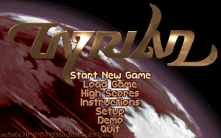
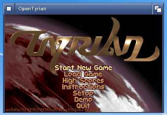
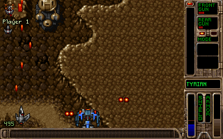
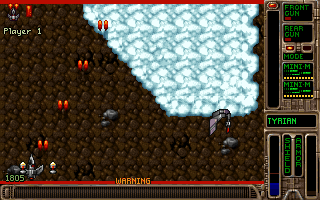

# OpenTyrian for AmigaOS 3.x / AmiCradle — TESTING

Source pin: `ac5d0e71f4245744350c6116ce24f10624da58f8`,
[upstream](https://github.com/opentyrian/opentyrian). GPL-2.0-or-later engine.
SDL2 (GFOpenGPU's SDL2.module), 68040 + FPU, libnix, OpenAmigaGCC 16.2.0-open3
or open4. Networking disabled.

Prepare with `scripts/game_port_prepare.py prepare --game opentyrian --allow-network`.
Build the exported pin offline, applying the checked-in patches (`patches/`, in
order, with no fuzz):

```sh
python3 build_open3.py --source build/game-ports/sources/opentyrian \
  --stove /path/to/verified-open3 --out build/opentyrian-open3 --jobs 2
python3 scripts/fetch_runtime_data.py --root . --game opentyrian --allow-network
```

The helper writes `receipt.json` and `build.log`; it does not deploy or fetch.
Put the binary beside `data/` with the contents of the upstream-linked Tyrian
2.1 ZIP (flat, lowercase names). User files go in `PROGDIR:User`.
Run `opentyrian --no-sound --no-joystick --data=data` for the muted smoke.

On Cradle, `stove_build` with target `.` runs `build-amiga.sh` (the same build,
the upstream pin fetched by the job; it takes the os32-gcc16 stove with
OpenAmigaGCC 16.2.0-open3 or open4 and records which in `receipt.json`), and
target `runtime-data` stages the pinned Tyrian 2.1 data for a lab as
`OpenTyrian/data`. Both are for labs; neither is a package.

### Display

The game draws 320x200. On an Amiga it starts on a 320x200 screen of its own
(SDL's real full screen, `SDL_WINDOW_FULLSCREEN`, in place of upstream's
desktop-sized `SDL_WINDOW_FULLSCREEN_DESKTOP`) with no CPU scaler; this needs
SDL2.module from gfopenrtg main at `210df77` or later. Alt+Return gives a
Workbench window of exactly 320x200 and back. With a scaler chosen the screen
takes the display mode closest to the scaled size. Setup > Graphics still offers the scalers and
scaling modes; `PROGDIR:User/opentyrian.cfg` keeps the choice.
`SetEnv OPENTYRIAN_FPS 1` logs the frames shown every five seconds (a file name
instead of `1` adds the lines to that file).

### Controls

Keyboard (upstream's defaults, changeable in Options > Keyboard): arrow keys
move, Space fires, Return changes the rear gun's mode, Ctrl and Left Alt fire
the left and right sidekicks, P pauses, Escape opens the in-game menu (and
leaves menus), Alt+Return switches screen and window. The mouse moves the ship
too.

Joysticks and pads come through SDL from GFOpenInput (lowlevel.library where
GFOpenInput isn't installed). Port 2's stick is SDL joystick 1. With
GFOpenInput every pad has SDL's game controller layout, so the Amiga build adds
to upstream's defaults (stick or d-pad moves, A fires, B changes mode, X and Y
the sidekicks, Back the menu, Guide pauses): the shoulders also fire the
sidekicks and Start opens the menu, which a CD32 pad (no Back or Guide) needs.
Options > Joystick shows and changes them; Reset to Defaults brings them back.

### Audio

Music (the game's OPL2 tunes, emulated) and sound effects are mixed by the game
into one 44.1 kHz 16-bit mono stream that SDL plays through AHI (OpenAHI's
driver on AmiCradle); `--no-sound` turns it off. The log says what SDL opened
(`Audio: ahi, 44100 Hz, 1 channel(s), 1024 samples a buffer`). With
`OPENTYRIAN_FPS` set, each five-second line also gives the buffers mixed and
the time spent mixing them: 215 or 216 buffers in five seconds (44100 / 1024 a
second) means none was late.

### Saves and settings

Everything the game writes is in `PROGDIR:User` (`patches/0001`), made on first
run: `tyrian.sav` (the ten save slots and the last level reached),
`tyrian.cfg` (upstream's game settings) and `opentyrian.cfg` (display,
keyboard and joystick choices). Saving from the Game Menu (Options > Save)
writes `tyrian.sav` at once; the two configuration files are written when the
game quits. Back up the drawer to keep them; the game data in `data/` is never
written.
The data digest is pinned in the runtime manifest. Assets stay external;
freeware is not permission to redistribute every asset without review.

### Package and icons

Target `package` (`package/build-amiga.sh`) builds the game as `.` does and
packs the release archive with `tools/make_package.py`:
`opentyrian-VERSION-68040.lha` (LhA level-1, `-lh5-`, written by
`tools/lha_archive.py`) holding the `OpenTyrian` drawer and `OpenTyrian.info`
beside it, with the `.sha256`, an Aminet `.readme`, `package.json`, the drawer
as it unpacks and `OpenTyrian.tar` (for a lab: `untar` unpacks it on the
Amiga). `package/package.json` lists what goes in the drawer: the program,
`ReadMe` (from `package/ReadMe.in`), `COPYING.txt` (the engine's GPL-2.0) and
`data/ReadMe.txt`, which says where the Tyrian 2.1 data comes from. The data
itself is not packed (`gameports/runtime-data.json`'s policy).

The drawer, the game and the documents have OS 3.5 GlowIcons (`icons/*.info`):
the classic four-colour picture for older Workbenches and two colour frames,
drawn from OpenTyrian's own program icon (`icons/art/opentyrian.png`, from
upstream's `linux/icons/tyrian-128.png`). They are committed, so the package
needs nothing else; to draw them again, with a DalsinAI/amicradle checkout:

```sh
python3 ../amicradle/scripts/port_icons.py icons/icons.json --out icons
```

## Observed 2 November 2026: SDL's real full screen

GFOpenRTG's SDL2 module now gives SDL's real full screen a screen of the
program's own in the mode closest to the window, drawn whole, and closes it
again on leaving full screen or ending (gfopenrtg #172, with #171 and #173,
merged on main at `210df77`). Commit `cff23ec` asks for it
(`patches/0002-amiga-presentation.patch`; `0004`'s last `video.c` hunk
header moves with it). Executable, built by Cradle's `stove_build` with the
`os32-gcc16` stove (OpenAmigaGCC 16.2.0-open4): SHA-256
`b80fe7130efe50d7907fad787c28b8be27b60db144feaf3181bc0031d8f15b51`
(770,820 bytes).

Run in `lab:ports-sdl2`, a fresh copy of Instance-32 (68040 + 68882,
Kickstart 47.100, RTG 1920x1080, AHI, muted), with SDL2.module built from
gfopenrtg `210df77` (SHA-256 `82e8be3d...`, 1,002,284 bytes) in both
`LIBS:OpenGPU/` and `LIBS:GFOpenGPU/`, the pinned data from `runtime-data`,
no `PROGDIR:User` before the first start, sound on,
`SetEnv OPENTYRIAN_FPS RAM:ot-fps.txt`, `opentyrian --data=data`.

- Display: the title on a 320x200 screen of the game's own (the RTG head
  reports 320x200), the frame whole, 1:1; the log has `window surface in
  video RAM (320x200, 1280 bytes a row)`. Alt+Return gave the 320x200
  window on the Workbench, and Alt+Return again the 320x200 screen.
- Play: 1 Player Arcade, Episode 1, Normal, level 1 (Tyrian) with
  `HoldKeys 60 HOLD 40 SWAY PERIOD 40` (fire held, swaying), 2,757 points;
  Esc, Quit Level, Quit Game and OK back to the title, Quit: the game ended,
  the Workbench came back, and `opentyrian.cfg` (with `fullscreen 0`,
  `scaler None`), `tyrian.cfg` and `tyrian.sav` were written to
  `PROGDIR:User`. The mouse clicks landed where they were aimed on the
  320x200 screen (OK, Quit).
- Frame rate (`OPENTYRIAN_FPS`) in play: **34.7 a second** in nearly every
  five-second window (34.0 to 36.6, one catch-up window of 42.5), the game's
  Normal pace of 34.8, with 215 or 216 audio buffers in each window (none
  late) and 11 to 20 % of the time in the mixer.
- Not right: in the first 80 seconds (title, the two Alt+Return switches,
  the menus, while full-size 1920x1080 lab screenshots were being taken)
  audio fell behind: 700 buffers in 18.3 s (38 a second against 43) with
  half the time in the mixer, then 397 in 9.2 s. It recovered by itself
  before play and stayed on time to the end. This is like the slow spells
  noted below; the cause is still not established.
- In the Quit Game box ("Are you sure you want to exit?"), Left lit OK
  but Return (and once Space) still went back to the Game Menu, three times;
  a mouse click on OK worked. Not looked into yet: it may be upstream's
  mixed mouse and keyboard handling in that box rather than anything of the
  port's.






## Observed 2 November 2026

Lab `lab:opentyrian`, a copy of Instance-32 (Kickstart 47.100, 68040 + 68882,
AGA plus the RTG board, OpenGPU's SDL2.module, openinput.library 1.3, AHI with
the acaudio driver), built by Cradle's `stove_build` with OpenAmigaGCC
16.2.0-open4 from this repository's patches 0001 to 0004 (executable SHA-256
`ac7115c810ddac443c4280632cc3fef1966a56b5b62ed370fa78e97d031dec64`), data
staged by `runtime-data/build-amiga.sh` (85 files from the pinned ZIP).

- Display: the frame is whole on a 640x480 screen at 2x (SDL's
  desktop-sized full screen, then the default; see above for the 320x200
  screen that replaced it), and in an exactly 320x200 Workbench window after
  Alt+Return (and back).
- Keyboard: menus, movement, fire, change fire mode, both sidekick keys, pause,
  the Escape menu and text entry all worked (see the step PRs for the
  screenshots).
- Joystick: GFOpenInput's port-2 stick is found (21-button game controller
  layout) and Options > Joystick shows the defaults, Start and the shoulders
  included. No stick or pad press could be sent from the lab tools, so pad
  play is not yet exercised.
- Audio: SDL opened AHI at 44.1 kHz mono, 1024-sample buffers. The lab is
  muted, so nothing was heard; the buffer count held at 43 a second (no late
  buffer) in menus, the attract run and play, with 8 to 21 % of the time in the
  mixer, except where noted below.
- Saves: a game saved to slot 1, the game quit, started again and loaded with
  the same level, credits, rear gun and sidekick. Quitting from the title
  writes `opentyrian.cfg`, `tyrian.cfg` and `tyrian.sav` to `PROGDIR:User`.
- Play: level 1 (Tyrian) played by hand with taps and then with fire held and
  the ship swaying (`tests/lab` HoldKeys); that ship was shot down within a
  minute and the game went back to the Game Menu as it should. Level 2 was
  reached with upstream's `--constant` test mode and its invincibility key
  (C, "Cheaters always prosper"): level 1's boss destroyed, then ASTEROID2
  played for several minutes. That run is a check of level change and level 2,
  not a fair completion by a player.
- Frame rate (`OPENTYRIAN_FPS`): 34.6 to 34.8 frames a second in menus and play
  on both levels, the game's own pace (Normal speed, 34.8), dipping to 33.3 in
  the busiest moments. Twice the game fell behind for about a minute (16.5 to
  30 frames a second, 177 to 209 audio buffers in five seconds, so stuttering
  sound): once in the first minute after the lab booted, and once at the start
  of the invincible level 1 run while other teams' labs shared the host. It
  recovered both times without any change; the cause is not established.
- Ctrl-C (`Break`) ends the game without writing `opentyrian.cfg`; that is
  upstream's handling of SDL's quit event. Quit from the menus to keep
  settings.

Remaining before release: a person's play through more levels with a CD32 or
USB pad, audio heard on a machine with sound, the two slow spells explained,
AGA without RTG, packaging (icon, drawer, notices, data fetch for users) and
the licence/data review. This is TESTING, not RELEASE.

## Observed 24 October 2026

Clean compile/link passed. Executable SHA-256:
`7b05261b65ed89aee05cf8c45e81027587f85718b7ac8af600aa91104e5951d3`.
Compiler archive SHA-256:
`9fcc136ab59e3bb5b91d2764d0bf290b709d72d7380be4ce0cdf005edf8eff21`.

Isolated copied lab, runtime `zen x86-64-v3 20261024T070109Z`, Kickstart
3.2.3 47.115, CRC32 `b18d3b67`, SDL_OPENGPU=0, muted. Title and moving
attract demo rendered, but the 320x200 window appeared to clip the scaled
picture. Keyboard/menu/gameplay control is not qualified. Both launches
exited via Escape with Shell RC 0 and created configuration/save-container
files under User. Creating a save container is not a gameplay save/load pass.

Remaining: full-frame presentation, deliberate menu/ship movement/fire,
actual game save/load, audio, input devices and repeat on intended ROM/runtime.
This is TESTING, not RELEASE. The isolated lab was stopped after the run;
Instance-32 and platform repositories were untouched.
